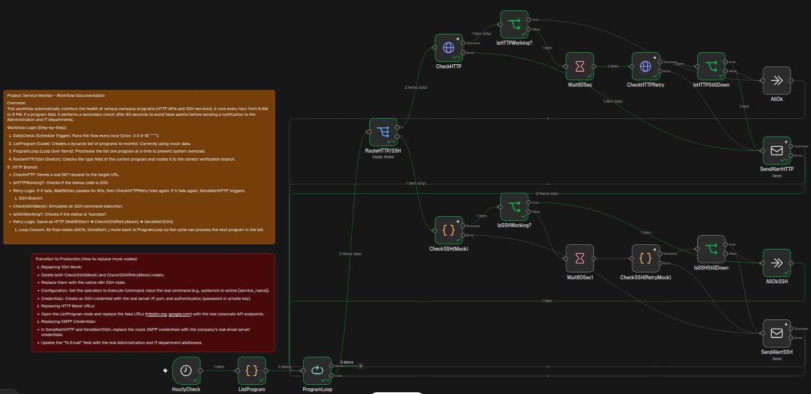

# n8n Service Monitor - Proof of Concept

This is a personal Proof of Concept (PoC) project created to demonstrate automated service monitoring using n8n. 

The workflow checks the health of various programs (HTTP APIs and SSH servers) and alerts the IT and Administration departments in case of failures.

## 🚀 Features
- **Dynamic Routing:** Fetches a list of programs and uses a Switch node to route checks to HTTP Request or SSH execution.
- **Retry Logic to avoid False Alarms:** If a service fails, the workflow waits 60 seconds and tries again before sending an alert.
- **Loop Management:** Processes items one by one to prevent system overload.
- **Error Handling:** Uses `Continue (using error output)` to ensure the loop never breaks, even if a service is completely unreachable or the email server fails.

## 🛠️ How it works
1. **Schedule Trigger:** Runs every hour from 9 AM to 6 PM.
2. **ListProgram (Code):** Generates a mock list of services to monitor.
3. **ProgramLoop:** Iterates through the list.
4. **RouteHTTP/SSH:** Routes the check based on the service type.
5. **Alerting:** Sends an email notification if the service is still down after the retry.

## 📌 Transition to Production
Currently, the SSH nodes and SMTP credentials are mocked. To use it in a real environment:
- Replace the `CheckSSH(Mock)` nodes with the native n8n SSH node (using real server IP, port, and private key/password).
- Replace the mock SMTP credentials with the real corporate email server.
- Update the URLs in the `ListProgram` node with the real API endpoints.

*Disclaimer: All company names, URLs, and data in this repository are entirely fictional and for demonstration purposes only.*
